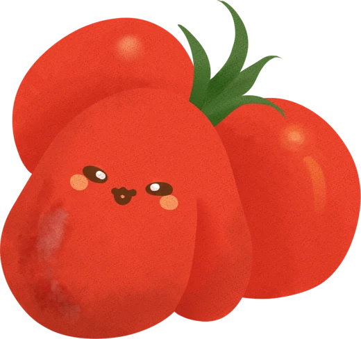

# 野菜絵の具 ／ ベジタブルファースト

東京造形大学のチーム「ベジタブルファースト」による、規格外野菜から作る「野菜絵の具」のプロジェクトサイトです。

## 見かた

`index.html` をブラウザで開くと表示されます。1ページ構成で、上のメニューから各項目に移動できます。

## フォルダ構成

- `index.html` … サイト本体
- `css/style.css` … 全体のデザイン
- `css/veg-peek.css`, `js/veg-peek.js` … スクロールで野菜が画面の端から顔を出す演出
- `js/main.js` … メニュー、トップのイラストの動き、写真の表示アニメーション
- `images/` … 写真・イラスト（`images/hero/` はトップのイラストのパーツ、`images/veg/` は野菜キャラクターの表情）

## 野菜キャラクターの置き方

```html
<section class="section" data-peek-area>
  …
  <div class="veg-peek" data-side="right" style="top: 0px"
       data-enter="images/veg/tomato-blush.webp"
       data-idle="images/veg/tomato-blush.webp"
       data-poke="images/veg/tomato-sparkle.webp" aria-hidden="true">
    <div class="veg-peek__body"></div>
  </div>
</section>
```

`data-side` は `left` / `right`、`data-poke` はカーソルを当てたときの表情です。文字と重ならない位置に自動で調整されます。

© 2026 ベジタブルファースト
